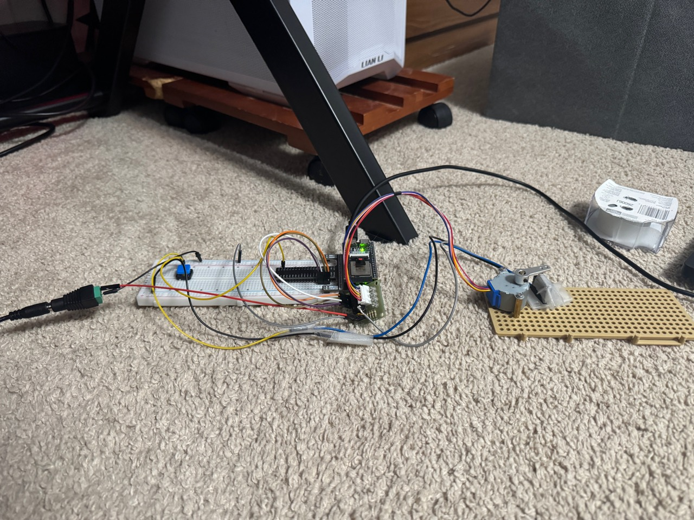
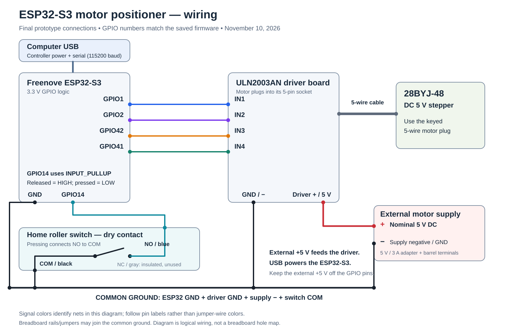

# ESP32-S3 Stepper Motor Positioning System

I built a bench prototype to control a 5 V 28BYJ-48 stepper motor with an ESP32-S3 and ULN2003 driver. I started with basic stepping and added serial commands, scheduled motion, stopping, home-input handling, and a Python STATUS logger.

**Completed first learning prototype — November 10, 2026.** I closed the demonstrated firmware, Python client, and first taped-switch prototype scope. Rigid mounting and measured positioning accuracy/repeatability are optional future improvements. [Completion record](docs/COMPLETION.md).



The photo shows the final first-prototype setup with the taped switch fixture. I reported an arm-triggered hands-free stop, followed by zero/homed/idle STATUS. Long-term retention and repeatability remain unmeasured.

## What I have working

- I can request targets from 0 to 1024 commanded steps after establishing a home reference.
- I service motion, serial input, and the home switch in the main loop using `millis()` timing.
- I reject invalid text, integer overflow, overlong commands, out-of-range targets, and new movement requests while busy.
- STOP cancels an active move or search and retains the commanded count. I observed the shaft stop and stay still in a recorded test.
- HOME searches in reverse with a 256-step budget and a 5-second timeout. A manually accepted switch press stops the search, assigns zero, and allows numeric targets.
- STATUS reports position, the home flag, and IDLE, MOVING, or HOMING.
- My first Python client collects five STATUS samples, adds elapsed times, saves a CSV, reloads it, and validates its fields and values.

Position is an **issued-step count**, not a measured shaft angle. The motor has no position feedback. A count can change without rotation if motor power is absent or the motor misses steps. Reset alone does not establish a physical home.

## Hardware and wiring

[Wiring diagram and final photos](docs/WIRING.md).



| Part | My setup |
| --- | --- |
| Controller | Freenove ESP32-S3, powered by USB |
| Motor and driver | 5 V 28BYJ-48 and ULN2003AN board |
| Motor supply | Separate nominal 5 V, 3 A adapter through a barrel-to-terminal adapter |
| Home switch | Normally open roller switch, GPIO14 to GND, using INPUT_PULLUP |
| Construction | Breadboard, predrilled mounting plate, shaft arm, standoffs and fasteners |

| ULN2003 input | ESP32 GPIO |
| --- | --- |
| IN1 | 1 |
| IN2 | 2 |
| IN3 | 42 |
| IN4 | 41 |

I connect the driver supply positive to the external 5 V supply and join driver, supply, and ESP32 grounds. The switch input reads LOW when pressed. On my tested switch, black is COM, blue is NO, and gray is NC; I use black and blue and leave gray insulated. I measured these contacts rather than relying on wire colors.

## Firmware

I open [Motor_Positioning_System.ino](firmware/Motor_Positioning_System/Motor_Positioning_System.ino) in Arduino IDE. My recorded development profile is ESP32S3 Dev Module with Arduino-ESP32 3.3.12. I select the connected board and port, verify, and upload. Serial Monitor uses **115200 baud** with a **newline** ending.

| Command | Behavior |
| --- | --- |
| HOME | Start a bounded reverse search while idle and the switch is released |
| 0 through 1024 | Schedule a target while idle and homed |
| STOP | Cancel motion or homing and report the retained count |
| STATUS | Report the current firmware state without commanding movement |

Example status: `STATUS position=0 homed=1 mode=IDLE`.

Before a home reference is established, numeric targets return Home First. During motion or homing, a new target returns Busy. A new HOME clears the previous reference; a canceled or failed HOME requires another successful search before numeric movement.

For the current temporary bench test, I can activate the switch by hand during HOME to assign a temporary zero. This tests the software path, not automatic mechanical homing. I keep the arm sweep clear and use STOP before adjusting the fixture. The current switch stop is an event on a new accepted press, not a continuous hardware interlock.

## Python client

I use a project-local environment. From this repository folder on Windows:

```powershell
python -m venv pc/.venv
.\pc\.venv\Scripts\python.exe -m pip install -r pc/requirements.txt
.\pc\.venv\Scripts\python.exe pc/status_client.py
```

I set `PORT` near the top of [status_client.py](pc/status_client.py) to the board's actual port and close Serial Monitor before running it. COM3 is my recorded setup, not a required port for another computer.

The client writes time-stamped files under pc/logs regardless of the terminal's working directory. It closes the serial port even when sample collection fails. Expected serial, timeout, parsing, and file errors print an error and exit with code 1. The client only requests STATUS; it does not run HOME or move the motor.

## Testing and completed scope

My [test notes](docs/TESTING.md) distinguish earlier firmware runs, simulated Python checks, real serial I/O, and physical observations. The Python client passed 58 offline/simulated checks and a real five-sample capture with CSV readback and exit code 0. The [sample CSV](docs/evidence/status-samples-20261102.csv) contains that recorded run.

I added short source comments before publication. The C++ executable tokens and Python syntax tree were unchanged; [the comparison record](docs/evidence/source-comments-20261102.json) links the commented source to its earlier tested revision. I have not rerun all hardware tests on this snapshot.

I closed the first prototype after manual HOME/physical-stop tests, one visual 200-to-0 return, and a reported hands-free arm-triggered stop using tape fastening. The supplied taped-switch excerpt shows final STATUS rather than a full HOME transition. My [completion record](docs/COMPLETION.md) and [mechanical iteration notes](docs/MECHANICAL_ITERATIONS.md) preserve the scope, DIY work, and limitations. Rigid support, arm-retention improvements, measured repeatability, loaded voltage/current, electrical coil release, and timing are optional extensions.

## References and progress

I started with the [Freenove ESP32-S3 Ultimate Starter Kit tutorials](https://docs.freenove.com/projects/fnk0082/en/latest/) and developed this project incrementally with guidance. My [progress notes](docs/PROGRESS.md) record the main milestones. The firmware and Python code contain simple comments explaining the functions and the choices behind them.
