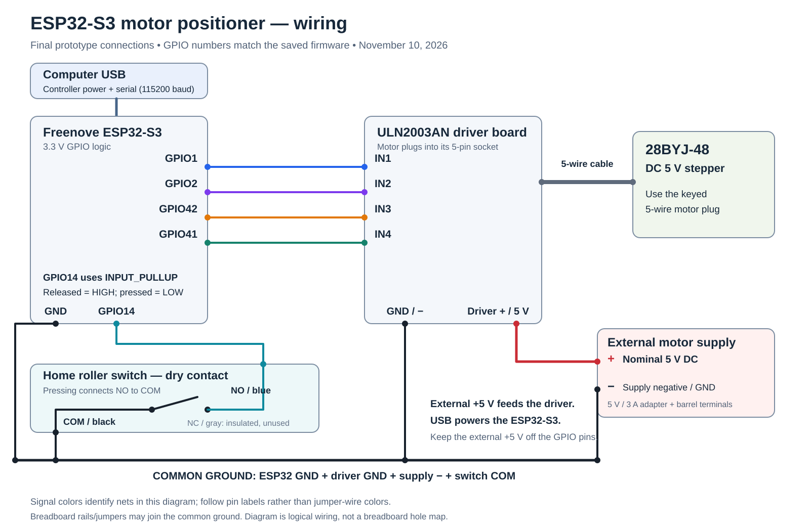
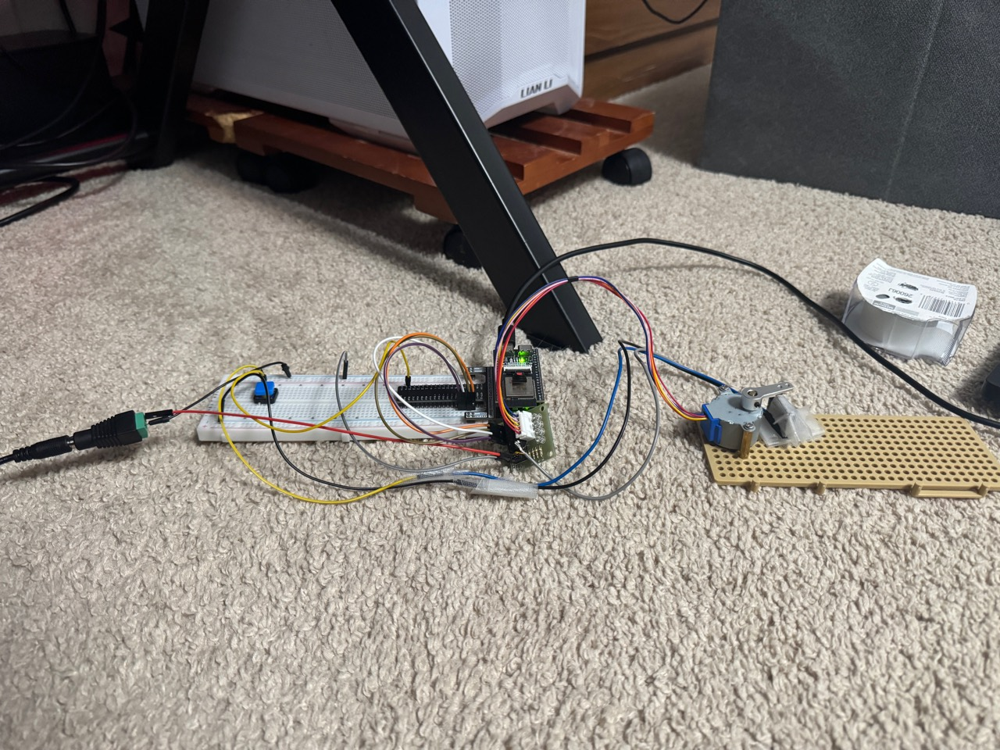
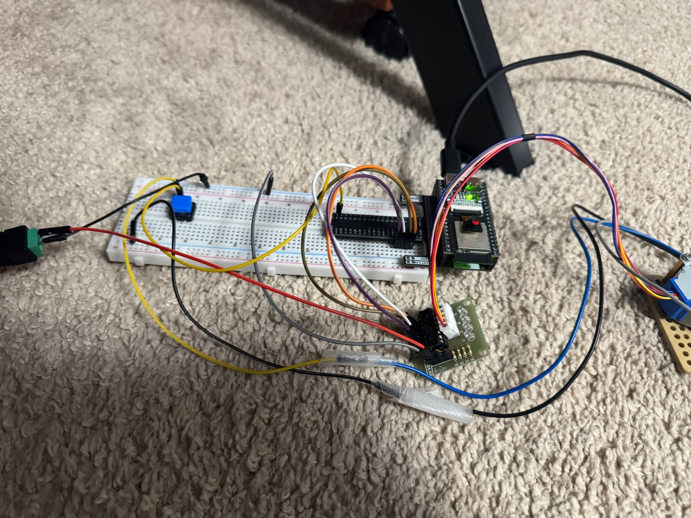
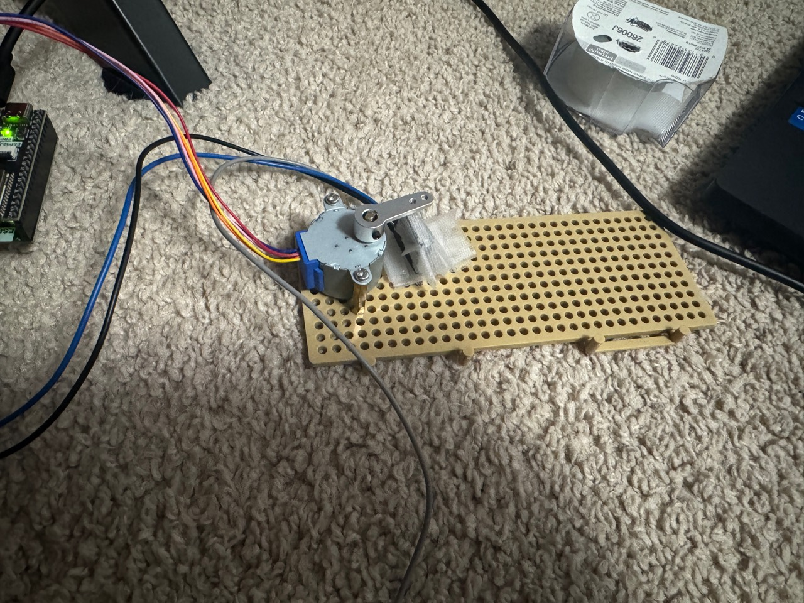

# My motor-positioner wiring

I documented these connections from my saved firmware and project wiring records. The diagram uses GPIO labels rather than physical header positions. Jumper colors in the photographs are not the diagram's color key.

[Download PNG](images/motor-wiring.png) | [Open vector SVG](images/motor-wiring.svg)

| Connection | Destination |
| --- | --- |
| ESP32 GPIO1 | ULN2003 IN1 |
| ESP32 GPIO2 | ULN2003 IN2 |
| ESP32 GPIO42 | ULN2003 IN3 |
| ESP32 GPIO41 | ULN2003 IN4 |
| ESP32 GPIO14 | Tested switch NO contact, blue lead |
| Switch COM, black lead | Common GND |
| Switch NC, gray lead | Insulated and unused |
| External nominal +5 V | Driver supply + |
| External supply negative | Common GND |
| ESP32 GND and driver GND | Common GND |
| Motor's keyed 5-wire plug | ULN2003 motor socket |
| Computer USB | ESP32 controller power and serial connection |

The home input uses INPUT_PULLUP: HIGH when released and LOW when the NO contact closes to COM. The black/blue/gray contact mapping comes from my measurements of this switch; it is not a universal wire-color rule.

I use separate USB controller power and external motor power. The external positive supply feeds the driver. Their grounds are connected together. The drawing does not connect external +5 V to an ESP32 GPIO or to its 3.3 V pin.

## Final prototype photographs

The photographs record the final first-iteration arrangement. Some endpoints are obscured by wires and tape, so the diagram follows the saved pin assignments and established wiring records rather than claiming a complete continuity check from the pictures.
